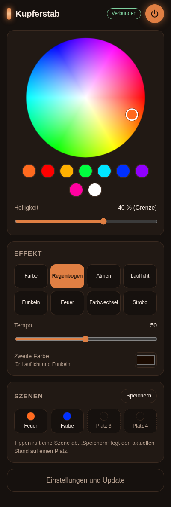
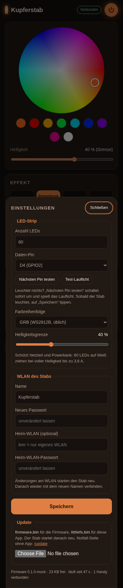

# Kupferstab

Firmware und Handy-App für den leuchtenden Kupferstab: Ein Wemos D1 mini (ESP8266) steuert einen
NeoPixel-Strip, der durch Löcher in Kupferrohren leuchtet. Gesteuert wird er vom Handy aus, Updates
kommen over the air.

## So funktioniert es auf der Party

1. Stab einschalten. Er spannt das WLAN **„Kupferstab“** auf (Passwort `kupferstab`).
2. Mit dem Handy verbinden. Die App öffnet sich von selbst. Falls nicht: **http://192.168.4.1**
   im Browser öffnen.
3. Für das Gefühl einer echten App: im Browser auf „Teilen → Zum Home-Bildschirm“ (iPhone) bzw.
   „⋮ → Zum Startbildschirm hinzufügen“ (Android) tippen. Danach startet sie im Vollbild.

 

Der Stab braucht weder Router noch Internet. Mehrere Handys können gleichzeitig steuern und sehen
die Änderungen der anderen sofort.

**Bluetooth gibt es nicht:** Der ESP8266 hat keinen Bluetooth-Chip, und auf dem iPhone kann kein
Browser Bluetooth-Geräte ansprechen. Deshalb läuft alles über das WLAN des Stabs.

## Erstes Flashen (einmalig, per USB)

Das alte OTA ist nicht mehr erreichbar, deshalb geht der erste Schritt per Micro-USB am D1 mini.
Danach braucht es kein Kabel mehr.

### Weg A: mit PlatformIO (empfohlen)

```sh
# einmalig: PlatformIO und Bun installieren
uv tool install platformio        # oder: pipx install platformio
curl -fsSL https://bun.sh/install | bash

# App bauen, dann Firmware und App auf den D1 mini schreiben
bun install
bun run build
cd firmware
pio run -e d1_mini -t upload      # Firmware
pio run -e d1_mini -t uploadfs    # App (Dateisystem)
```

PlatformIO findet den USB-Port meist selbst. Wenn nicht, gib ihn mit `--upload-port` an:
`/dev/cu.usbserial-*` (Mac) bzw. `COM3` (Windows). Erkennt der Rechner den D1 mini gar nicht,
fehlt der Treiber für den USB-Chip **CH340**.

### Weg B: im Browser, ohne Installation

Mit Chrome oder Edge am Laptop:

1. https://espressif.github.io/esptool-js/ öffnen, auf **Connect** klicken und den D1 mini wählen.
2. Zwei Dateien eintragen: `firmware.bin` an Adresse **0x0**, `littlefs.bin` an **0x200000**.
3. **Program** klicken und danach den D1 mini kurz vom Strom trennen.

Die beiden Dateien entstehen mit `pio run -e d1_mini` und `pio run -e d1_mini -t buildfs` unter
`firmware/.pio/build/d1_mini/`.

### Danach

Beim Start läuft ein **Kupfer-Lauflicht** über den Strip. Läuft es über alle LEDs, stimmen Pin und
Anzahl. Wenn nicht, siehe [Fehlersuche](#fehlersuche).

## Updates over the air

**Über die App:** Einstellungen → Update → Datei wählen.

- `firmware.bin` aktualisiert die Firmware.
- `littlefs.bin` aktualisiert die App.

Der Stab startet danach neu. LED-Anzahl, Pin, WLAN und Szenen bleiben erhalten, auch bei einem
App-Update.

**Notfall-Seite:** http://192.168.4.1/update ist fest in die Firmware eingebaut. Sie funktioniert
also auch dann, wenn die App fehlt oder kaputt ist.

**Vom Laptop:** Der Laptop muss im WLAN des Stabs sein.

```sh
cd firmware
pio run -e ota -t upload          # Firmware, Passwort: kupferstab
pio run -e ota -t uploadfs        # App
```

## Einstellungen

Alles in der App unter **Einstellungen**, ohne neu zu flashen:

| Einstellung | Standard | Hinweis |
| --- | --- | --- |
| Anzahl LEDs | 60 | 1–600 |
| Daten-Pin | D4 (GPIO2) | „Nächsten Pin testen“ schaltet live um |
| Farbreihenfolge | GRB | WS2812B ist GRB; wenn Rot und Grün vertauscht sind: RGB |
| Helligkeitsgrenze | 40 % | schützt Netzteil und Powerbank |
| WLAN-Name / Passwort | Kupferstab / kupferstab | **Passwort vor der Party ändern** |
| Heim-WLAN | leer | optional, fürs Entwickeln; der Stab bleibt zusätzlich im eigenen WLAN erreichbar, im Heim-WLAN unter `http://kupferstab.local` |

Das OTA-Passwort für den Laptop ist `kupferstab`. Ändern lässt es sich über das Protokoll
(`otaPass`), siehe [docs/protocol.md](docs/protocol.md).

## Fehlersuche

| Symptom | Ursache und Abhilfe |
| --- | --- |
| Strip bleibt dunkel, App geht | Falscher Pin: Einstellungen → „Nächsten Pin testen“ antippen, bis das Lauflicht kommt, dann „Speichern“. |
| Nur ein Teil leuchtet | LED-Anzahl zu klein eingestellt, oder eine Daten-Unterbrechung im Strip (ab dem ersten dunklen Pixel). |
| Rot und Grün vertauscht | Farbreihenfolge auf RGB stellen. |
| Flackern, zufällige Farben | Datenleitung zu lang oder Pegel zu niedrig: 330-Ω-Widerstand in die Datenleitung, besser ein Pegelwandler 3,3 V → 5 V (z. B. 74AHCT125). |
| Wird rot/orange bei Weiß, ESP startet neu | Netzteil zu schwach: Helligkeitsgrenze senken oder 5 V auch am anderen Strip-Ende einspeisen. |
| WLAN „Kupferstab“ taucht nicht auf | D1 mini neu starten; nach einer WLAN-Änderung heißt das Netz so, wie du es eingestellt hast. |
| Passwort vergessen | Neu per USB flashen. Die Einstellungen bleiben dabei erhalten, deshalb vorher mit `pio run -t erase` den Flash löschen. |

## Entwickeln

```sh
bun install
bun run build      # App nach app/dist/ und firmware/data/
bun run mock       # simulierter Stab: http://localhost:8080
bun test           # Protokoll und Hilfsfunktionen
bun run typecheck
bun run fw         # Firmware bauen
bun run fs         # App bauen + Dateisystem-Image
```

Der simulierte Stab spricht dasselbe Protokoll wie die Firmware. Damit lässt sich die App ohne
Hardware im Browser ausprobieren.

| Ordner | Inhalt |
| --- | --- |
| `firmware/` | PlatformIO-Projekt (C++, Arduino-Framework) |
| `app/src/` | Handy-App (TypeScript ohne Framework) |
| `app/mock/` | simulierter Stab |
| `scripts/build-app.ts` | baut die App zu einer gzippten Seite plus Manifest und Icons |
| `docs/protocol.md` | Nachrichten zwischen App und Stab |
| `docs/plans/` | Umsetzungspläne |
