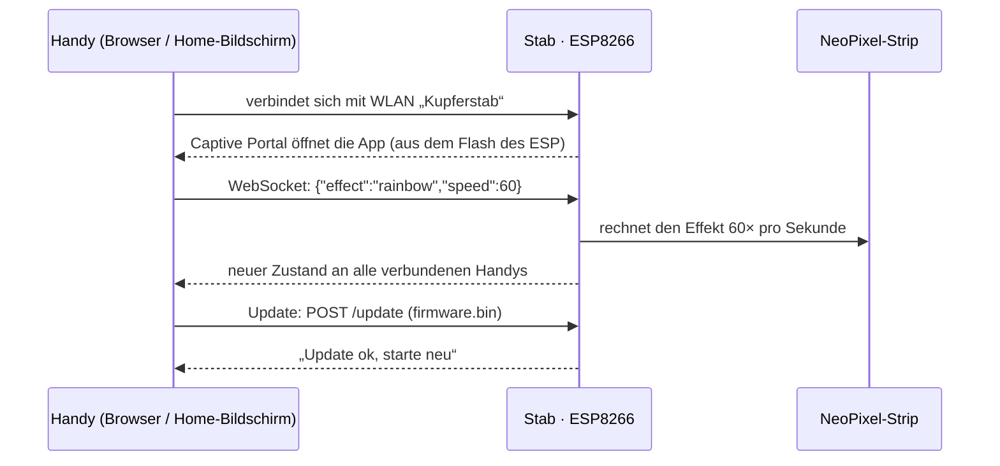

# 0001 · Firmware und Handy-App für den Kupferstab

**Tier `large`**: neues Repo, neue Abhängigkeiten (PlatformIO, ESP8266-Bibliotheken) und eine
Hardware-Frage (ESP8266 behalten oder tauschen), die über den ganzen Rest entscheidet.

## 1. Prognose

**Wofür.** Auf der Party steuerst du den Stab vom Handy aus: Farbe, Helligkeit, Effekte und
Geschwindigkeit. Neue Firmware spielst du ohne Kabel ein, über die App selbst. → [3.2](#32-welle-2--firmware), [3.3](#33-welle-3--app)

**Was sich ändert**

- Der Stab spannt ein eigenes WLAN auf, **„Kupferstab“**, mit Passwort. Er braucht keinen
  Router, das funktioniert also auch auf der Party.
- Sobald du dich verbindest, öffnet das Handy die App von selbst (Captive Portal, wie im
  Hotel-WLAN). Sonst erreichst du sie unter `http://192.168.4.1`.
- Die App lässt sich zum Home-Bildschirm hinzufügen und startet dann im Vollbild wie eine
  App: Farbrad, Helligkeit, Effekt-Kacheln, Tempo und Lieblings-Szenen.
- **Updates over the air**: In der App wählst du unter „Einstellungen → Update“ eine
  `.bin`-Datei aus, Firmware oder App. Der Stab startet danach neu. Vom Laptop geht das
  zusätzlich mit `pio run -t upload` über WLAN, mit Passwort.
- Anzahl der LEDs, Daten-Pin, Helligkeitsgrenze und WLAN-Name stellst du in der App ein.
  Dafür muss nichts neu geflasht werden.
- Nur das **erste** Flashen geht per USB, weil der Zugriff auf das alte OTA weg ist. Ab dann
  läuft alles kabellos.

**Warum kein Bluetooth.** Der Wemos D1 mini (ESP8266) hat **kein Bluetooth**. Zusätzlich
funktioniert Web Bluetooth auf dem iPhone in keinem Browser (Safari unterstützt es nicht).
Mit dem vorhandenen Board ist WLAN deshalb der Weg, der auf jedem Handy klappt. Bluetooth
ginge nur, wenn du den D1 mini gegen einen ESP32 tauschst, und auch dann nur auf Android
(→ Frage Q1).

**Was es kostet.** Ca. 3–4 Stunden Lauf. Danach pflegst du zwei Teile in einem Repo: die
Firmware (`firmware/`, C++ mit PlatformIO) und die App (`app/`, TypeScript mit Bun). Ein
Befehl baut die App in das Dateisystem der Firmware.

**Was der Lauf noch kostet.** Nach der Freigabe dieses Plans kein weiteres Gate. Du hörst
von mir, wenn der Pull Request offen ist. Den prüfst du und mergst ihn, das ist die Abnahme.
Das Flashen per USB machst du danach selbst, die Schritte stehen im README und im PR.

**Bewusst nicht dabei**

- Bluetooth (geht mit dem ESP8266 nicht, siehe oben).
- Ein Wechsel auf WLED. Das ist eine fertige Open-Source-Firmware für LED-Strips. Ich
  schreibe stattdessen eine eigene, schlanke Firmware passend zum Stab (→ Frage Q2).
- Musik- oder Mikrofon-Reaktion, Sync mehrerer Stäbe, Akku-Anzeige.
- Ein echter Offline-Service-Worker: Browser erlauben den nur über HTTPS, und der ESP liefert
  HTTP. Für dich heißt das: Die App funktioniert, sobald du im Stab-WLAN bist, und das musst
  du zum Steuern ohnehin sein.
- Testen auf der echten Hardware: Ich kann bauen und gegen einen simulierten Stab testen,
  aber nicht flashen.

**Risiko.** Am wahrscheinlichsten: Daten-Pin oder LED-Anzahl stimmen nach dem ersten
Flashen nicht. **Woran du es merkst:** Der Strip bleibt dunkel oder leuchtet nur zum Teil,
die App erreichst du aber trotzdem. Pin und Anzahl stellst du dann in der App ein, ohne neu
zu flashen. Wenn es danach immer noch flackert, liegt es meist am fehlenden Pegelwandler
(3,3 V → 5 V) oder an der Stromversorgung, nicht an der Software. → [3.2](#32-welle-2--firmware)

## 2. Stopp, wenn

- der Umfang über diesen Plan hinauswächst, z. B. Bluetooth-Hardware, Musik-Sync oder mehrere Stäbe;
- Datenverlust möglich wird: Das gilt hier nicht für Nutzerdaten. Gemeint ist ein Update-Weg,
  der den ESP ohne USB-Zugang unbrauchbar machen könnte. Dann frage ich, bevor ich ihn einbaue;
- der Plan eine Lücke hat, die ich nur durch Raten schließen könnte;
- ein Build oder Test nach drei Anläufen nicht grün ist;
- sich eine Annahme dieses Plans als falsch herausstellt, z. B. dass der D1 mini 4 MB Flash hat.

## 3. Plan

### 3.1 Welle 1 · Fundament

- `firmware/`: PlatformIO-Projekt, `board = d1_mini`, Framework Arduino, Dateisystem LittleFS
  (4 MB Flash: 1 MB Sketch, 1 MB OTA-Puffer, ca. 2 MB Dateisystem).
  **Fertig, wenn** `pio run` ein leeres Gerüst baut.
- `app/`: Bun-Projekt, TypeScript ohne Framework, damit die App klein bleibt (Ziel < 60 KB gzip).
  Prettier-Konfiguration nach `nfl-core:prettier`. **Fertig, wenn** `bun run build` eine
  `index.html` erzeugt.
- `scripts/build-fs.ts`: baut die App, gzippt sie nach `firmware/data/`. **Fertig, wenn**
  `pio run -t buildfs` ein LittleFS-Image mit der App erzeugt.

### 3.2 Welle 2 · Firmware

- **WLAN**: Access Point „Kupferstab“ (WPA2, Passwort in der App änderbar, Standard im
  README). Optional verbindet er sich mit dem Heim-WLAN fürs Entwickeln; schlägt das in
  15 s fehl, fällt er auf den Access Point zurück. DNS-Server für das Captive Portal, mDNS
  `kupferstab.local` im Heim-WLAN.
- **Einstellungen**: JSON auf LittleFS mit LED-Anzahl, Daten-Pin, Farbreihenfolge (GRB/RGB),
  Helligkeitsgrenze, WLAN, letzter Zustand. Nach einem Neustart steht der letzte Effekt wieder da.
- **LED-Ausgabe**: Adafruit NeoPixel. Pin und Anzahl lassen sich zur Laufzeit setzen.
  Standard ist **D4 / GPIO2**, die Grenze 40 % Helligkeit, damit USB und Powerbank nicht
  einbrechen. Beim Start läuft kurz ein Test (Lauflicht in Kupferfarbe), damit man sieht,
  ob Pin und Anzahl stimmen.
- **Effekte**: Farbe, Regenbogen, Atmen, Lauflicht, Funkeln, Feuer, Farbwechsel, Strobo.
  Jeder Effekt hat Tempo und Farbe als Parameter.
- **Steuerung**: WebSocket `/ws` mit JSON-Nachrichten (Zustand setzen, Zustand an alle
  senden), dazu `GET /api/state` und `POST /api/config`.
- **OTA**: `POST /update`, für Firmware und Dateisystem-Image. Die Erkennung läuft über
  das Formular-Feld, geprüft mit `Update.begin`/`Update.end`. Dazu ArduinoOTA mit Passwort,
  für Updates vom Laptop.
- **Fertig, wenn** `pio run` und `pio run -t buildfs` fehlerfrei bauen und das
  Firmware-Image unter 1 MB bleibt.

### 3.3 Welle 3 · App

- Oberfläche: großes Farbrad, Helligkeit, Effekt-Kacheln, Tempo, 4 speicherbare Szenen.
  Unter Einstellungen: LEDs, Pin, WLAN und Update mit Dateiauswahl und Fortschrittsbalken.
- Manifest, Icons und `apple-mobile-web-app-capable`, damit sie sich zum Home-Bildschirm
  hinzufügen lässt und im Vollbild startet. Verbindungsanzeige, die nach einem Abbruch
  automatisch neu verbindet.
- **Fertig, wenn** `bun run build` fertig ist und die gzippte App unter 60 KB bleibt.

### 3.4 Welle 4 · Prüfen

- `bun test`: Protokoll (Nachrichten bauen und lesen) und Zustands-Logik der App.
- `app/mock/`: ein simulierter Stab in Bun mit WebSocket und `/update`, der das Protokoll
  der Firmware spricht. Damit lässt sich die App im Browser ohne Hardware ausprobieren.
- Screenshot der App im Headless-Chrome gegen den simulierten Stab (Handy-Breite, hell und dunkel).
- **Fertig, wenn** Tests, Firmware-Build, Dateisystem-Build und die Screenshots stehen.

### 3.5 Welle 5 · Doku und Pull Request

- README auf Deutsch: Erst-Flash per USB, Schritt für Schritt (PlatformIO oder esptool, dazu
  der Weg, falls noch WLED drauf ist), OTA-Update, Verkabelung, Fehlersuche bei dunkler LED.
- Pull Request mit dem Walkthrough als Beschreibung.

## 4. Entscheidungslog

| Entscheidung | Warum | Verworfen |
| --- | --- | --- |
| WLAN statt Bluetooth | ESP8266 hat kein BT, und iOS hat kein Web Bluetooth | BLE über ESP32 (→ Q1) |
| App liegt im Flash des ESP | Handy und Stab brauchen kein Internet, alles bleibt in einer Hand | App auf GitHub Pages: HTTPS-Seite darf nicht mit `http://192.168.4.1` reden (Mixed Content) |
| Adafruit NeoPixel statt NeoPixelBus | Pin und Anzahl zur Laufzeit änderbar | NeoPixelBus mit DMA: Pin steht fest im Code (RX/GPIO3) |
| ESPAsyncWebServer + WebSocket | mehrere Handys gleichzeitig, Push des Zustands | Polling über HTTP |
| **Freigabe 2026-10-30:** Q1 a, Q2 a, Q3 a; C1 ✗ („glaube ja, weiß es nicht, Port nicht sichtbar“) | | |
| Pin-Suche in der App („Nächsten Pin testen“ schaltet live um und spielt das Lauflicht) | Antwort auf C1: Pin unbekannt, Stab ist zu | Pin raten und neu flashen |
| **Abweichung:** Einstellungen, Zustand und Szenen im EEPROM-Bereich statt auf LittleFS | Ein App-Update überschreibt das ganze Dateisystem und hätte LED-Anzahl, Pin und WLAN gelöscht | LittleFS wie im Plan |
| Notfall-Seite `/update` fest in der Firmware | Updates bleiben möglich, auch wenn die App fehlt oder ein Dateisystem-Update schiefging (Stopp-Kriterium „unbrauchbar ohne USB“) | Update nur über die App |
| Firmware-Upload prüft das erste Byte (0xE9, gzip 0x1F) | Ein versehentlich als Firmware hochgeladenes App-Image würde den ESP bis zum USB-Flash lahmlegen | keine Prüfung |
| Plattform `espressif8266@4.2.1`, Bibliotheken exakt gepinnt | reproduzierbare Builds | Versionsbereiche |
| Schriftliste ohne `system-ui` | Im Container zeigte `system-ui` auf eine Monospace-Schrift; Handys nehmen `-apple-system` bzw. Roboto | `system-ui` vorn |
| _backlog_: GitHub-Action, die `firmware.bin` und `littlefs.bin` bei jedem Release baut | Updates ohne lokale Toolchain, nur mit Datei-Upload in der App | – |
| _backlog_: OTA-Passwort in der App änderbar machen | Heute nur über das Protokoll (`otaPass`) | – |

## 5. Doku-Folgen

- README (neu): Aufbau, Erst-Flash, OTA, Verkabelung, Fehlersuche.
- `CONTEXT.md` (neu): Begriffe wie Szene, Effekt, Stab, Captive Portal und der Aufbau aus Firmware und App.
