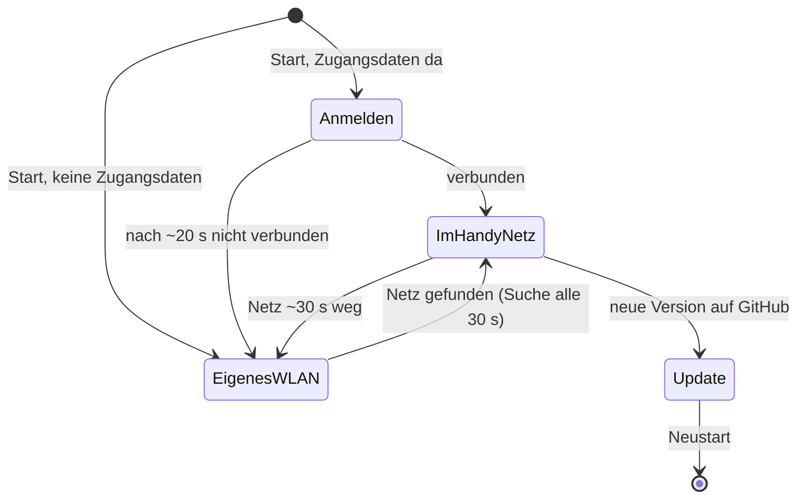

# 0002 · Stab bucht sich ins Handy-WLAN ein und holt Updates von GitHub

**Tier `large`**: Das Repo wird öffentlich, und das lässt sich praktisch nicht zurücknehmen. Dazu
kommt neue Infrastruktur (eine GitHub Action, die Releases baut), und das WLAN-Verhalten des Stabs
ändert sich so, dass man ihn anders findet als bisher.

## 1. Prognose

**Wofür.** Du musst dich nicht mehr mit dem Stab verbinden. Er bucht sich in deinen Handy-Hotspot
ein, und neue Versionen holt er sich selbst von GitHub, sobald du dort auf einen Knopf drückst.
→ [3.1](#31-welle-1--wlan-umdrehen), [3.2](#32-welle-2--update-von-github)

**Was sich ändert**

- **Beim Start sucht der Stab zuerst dein Netz.** Sind Zugangsdaten hinterlegt, versucht er
  sich etwa 20 Sekunden lang anzumelden. Klappt das, macht er **kein eigenes WLAN** auf. Die App
  erreichst du dann im Handy-Browser unter **`http://kupferstab.local`** (→ Q3).
- **Klappt es nicht, öffnet er wie bisher „Kupferstab“** samt Captive Portal. Dort trägst du in
  den Einstellungen Name und Passwort deines Hotspots ein. Ein Neustart ist dafür nicht mehr
  nötig.
- **Solange sein eigenes WLAN offen ist, sieht der Stab alle 30 Sekunden nach**, ob dein Netz in
  Reichweite ist. Dazu genügt es, dass du dich vom Stab trennst und den Hotspot einschaltest.
  Er meldet sich dann bei dir an und schließt sein eigenes WLAN, fertig.
- **Ist dein Netz später weg**, zum Beispiel weil der Hotspot aus ist, öffnet er nach etwa
  30 Sekunden wieder „Kupferstab“. Kommt dein Netz zurück, wechselt er wieder zu dir.
- **Das Repo wird öffentlich.** Unter GitHub → Actions → „Release“ gibt es einen Knopf
  **„Run workflow“**. Er baut Firmware und App und veröffentlicht sie als Release mit neuer
  Versionsnummer.
- **Der Stab holt sich das selbst** (→ Q1). Er prüft nach jeder Anmeldung in deinem Netz und
  danach alle 30 Minuten. In der App gibt es zusätzlich den Knopf „Jetzt nach Updates suchen“.
  Ist eine neue Version da, lädt er sie, spielt sie ein und startet neu. Das Licht ist dabei
  ein paar Sekunden aus.
- Das lokale Update per Datei-Upload in der App und per `espota` bleibt als Rückfallweg.

**Was es kostet.** Etwa 3 bis 4 Stunden Lauf. Danach gibt es in der Firmware zusätzlich einen
kleinen WLAN-Zustandsautomaten und einen Update-Client für HTTPS. Im Repo kommt eine GitHub
Action dazu, die du nicht pflegen musst, solange PlatformIO und Bun so bleiben.

**Was der Lauf noch kostet.** Nach dieser Freigabe hörst du erst zum Walkthrough wieder von mir.
Dort brauche ich einmal deine Hände: Hotspot-Daten eintragen und einen ersten Release auslösen.
Die neue Firmware muss **einmal noch lokal** auf den Stab (USB, wie eben). Die jetzige Firmware
kennt das Selbst-Update noch nicht.

**Was ich bewusst nicht mache**

- Mehrere gespeicherte Netze. Es gibt genau eins, deinen Hotspot.
- Eine App, die im Internet liegt (GitHub Pages). Eine HTTPS-Seite darf nicht mit dem Stab unter
  `http://` reden, das blockiert der Browser.
- Automatisches Zurückrollen, wenn eine neue Firmware nicht startet. Rückfallweg bleibt USB.
- Verschlüsselte Zugangsdaten auf dem Stab. Sie liegen wie heute im Flash.

**Risiko.** Am wahrscheinlichsten geht schief, dass der Stab deinen Hotspot nicht sieht. Den
ESP8266 gibt es nur mit 2,4 GHz, und neuere iPhones machen den Hotspot standardmäßig auf 5 GHz.
**Woran du es merkst:** Der Stab öffnet immer wieder „Kupferstab“, obwohl dein Hotspot an ist. Die
Abhilfe ist ein Schalter auf dem iPhone, „Kompatibilität maximieren“. Den Schritt nehme ich in die
Anleitung auf.

### Offene Fragen (Gate)

- **Q1 · Wann installiert der Stab ein Update?** (a) Automatisch, sobald er eine neue Version
  sieht. Das prüft er nach jeder Anmeldung, alle 30 Minuten und auf Knopfdruck in der App.
  (b) Er meldet nur „Update verfügbar“, installiert wird erst nach einem Tipp in der App.
  *Empfehlung (a)*: So hast du es beschrieben, und der Neustart dauert nur Sekunden.
- **Q2 · Wie sicher muss der Download sein?** (a) Die Firmware wird signiert: Der private
  Schlüssel liegt als Secret auf GitHub, der öffentliche in der Firmware, und der Stab spielt
  nur Firmware ein, die mit deinem Schlüssel unterschrieben ist. (b) Keine Prüfung, der Stab
  nimmt, was unter der Release-URL liegt. *Empfehlung (a)*: Ein öffentliches Repo und ein Gerät,
  das sich selbst neu flasht, sollten nicht davon abhängen, dass niemand dazwischenfunkt. Das
  kostet etwa 30 Minuten und ein Secret.
- **Q3 · Welches Handy macht den Hotspot?** (a) iPhone: `kupferstab.local` funktioniert dort in
  Safari zuverlässig. (b) Android: Dort lösen viele Browser `.local` nicht auf. Dann zeigt die
  App, solange du noch mit „Kupferstab“ verbunden bist, die Adresse an, die der Stab in deinem
  Netz bekommt. Zusätzlich blinkt der Strip beim Verbinden einmal die letzte Zahl der
  IP-Adresse.

## 2. Stopp, wenn

- der Umfang über diesen Plan hinauswächst, z. B. mehrere Netze, Rollback oder App im Internet;
- Datenverlust möglich wird: Gemeint ist ein Update-Weg, der den Stab ohne USB unbrauchbar machen
  kann. Ein Dateisystem-Update schreibt deshalb nur einzelne App-Dateien, nie das ganze Image;
- der Plan eine Lücke hat, die ich nur durch Raten schließen könnte;
- ein Build oder Test nach drei Anläufen nicht grün ist;
- sich eine Annahme als falsch herausstellt, z. B. dass HTTPS zu GitHub mit dem freien Heap des
  ESP8266 klappt (BearSSL braucht etwa 20 KB);
- etwas im Repo steht, das nicht öffentlich werden darf. Dann mache ich es nicht öffentlich und
  frage.

## 3. Plan

Branch `wifi-client-self-update`, abgezweigt von `firmware-pwa` (PR #3). Der Pull Request geht
gegen `firmware-pwa`.

### 3.1 Welle 1 · WLAN umdrehen

- `firmware/src/wifi.{h,cpp}` (neu): Zustandsautomat `Connecting → Station | AccessPoint`.
  Station: nur `WIFI_STA`, kein DNS-Server, mDNS `kupferstab`. AccessPoint: `WIFI_AP` mit DNS und
  Captive Portal wie heute, alle 30 s ein asynchroner Scan nach `staSsid`. Gefunden → `WIFI_AP_STA`,
  `WiFi.begin`; verbunden → AP aus. In Station ~30 s ohne Verbindung → AccessPoint.
  Fertig, wenn alle Übergänge auf dem Stab per seriellem Log zu sehen sind.
- `web.cpp`: `setupWifi` raus, `wifi::begin()`/`wifi::loop()` rein. DNS nur im AccessPoint.
  `isOurHost` kennt `kupferstab.local` und die Station-IP.
- `config.cpp`: Eine Änderung an `staSsid`/`staPass` startet den Stab nicht mehr neu, sie geht an
  `wifi::credentialsChanged()`. AP-Name und AP-Passwort starten weiter neu.
- `info` im Zustand bekommt `mode` (`ap`/`sta`) und `staIp`. Protokoll und Tests in `app/` passen
  sich an.
- App, Einstellungen: Abschnitt „Handy-Hotspot“ (vorher „Heim-WLAN“) mit Hinweis auf
  `kupferstab.local` und, bei Q3 b, der Station-IP.

### 3.2 Welle 2 · Update von GitHub

- `.github/workflows/release.yml`: `workflow_dispatch`, baut die App (Bun) und die Firmware
  (PlatformIO). Version `0.<run_number>.0`, als `FW_VERSION` über `PLATFORMIO_BUILD_FLAGS`.
  Bei Q2 a signiert sie die Firmware mit dem Secret `SIGNING_KEY`. Hängt `firmware.bin`, die
  App-Dateien und `manifest.json` (`version`, Dateien, SHA-256) an ein Release `v<version>`.
- `firmware/src/selfupdate.{h,cpp}` (neu): Holt
  `https://github.com/Niklas-Flaig/kupferstab/releases/latest/download/manifest.json` und folgt
  den Weiterleitungen. Ist die Version neuer: zuerst die App-Dateien einzeln nach LittleFS (in
  `.tmp`-Dateien, SHA-256 prüfen, dann umbenennen), danach die Firmware über `ESPhttpUpdate` und
  ein Neustart. Läuft nur in der Station. Ergebnis und Fehler kommen als `notice` an die App.
- App: Knopf „Jetzt nach Updates suchen“ unter „Update“, Protokoll `{"t":"checkUpdate"}`.
- Bei Q2 a: Schlüsselpaar erzeugen, öffentlichen Schlüssel als `firmware/public.key` ins Repo,
  den privaten per `gh secret set SIGNING_KEY`. Er landet nie im Repo.

### 3.3 Welle 3 · Prüfen

- `bun test`, `pio run -e d1_mini` grün, Freier Heap im Log vor und nach einer TLS-Verbindung.
- Auf dem angeschlossenen Stab per USB flashen, die AP-Rückfall-Übergänge seriell beobachten.
- Repo öffentlich machen (`gh repo edit --visibility public --accept-visibility-change-consequences`),
  ersten Release auslösen und prüfen, dass `manifest.json` öffentlich abrufbar ist.
- Ende-zu-Ende mit deinem Hotspot im Walkthrough. Dafür brauche ich dich.

### 3.4 Welle 4 · Doku und Pull Request

- README: Abschnitte „So funktioniert es auf der Party“, „Einstellungen“, „Updates“ neu;
  `docs/protocol.md`: `mode`, `checkUpdate`; `CONTEXT.md`: Begriffe Handy-Hotspot, Release.
- PR gegen `firmware-pwa`, Walkthrough als Beschreibung.

## 4. Entscheidungslog

| Entscheidung | Warum | Verworfen |
| --- | --- | --- |
| App-Update dateiweise statt LittleFS-Image | Das Image ist 2 MB groß, die App nur ~12 KB. Ein abgebrochenes Image-Update würde die App löschen. | `littlefs.bin` über `ESPhttpUpdate.updateFS` |
| `releases/latest/download/…` statt GitHub-API | keine JSON-Antwort von 10 KB parsen, kein Rate-Limit | `api.github.com/repos/…/releases/latest` |
| **Freigabe 2026-10-31:** Q1 b, Q2 a, Q3 b (Android); C1 ✓; C2 ✗ („wahrscheinlich ja nicht … wegen Android??“) | | |
| Q1 b: Stab prüft selbst, installiert nur auf „Version … installieren“ in der App | Antwort Q1 | automatisch |
| Antwort auf C2: Die Verknüpfung auf dem Home-Bildschirm hängt an der Adresse. Auf Android ist das die IP, die der Hotspot vergibt, und die kann sich ändern | Auf Android 12 und älter löst der Browser `kupferstab.local` oft nicht auf, ab Android 13 meistens schon (Forenberichte, keine offizielle Quelle) | – |
| Stab merkt sich seine letzte Hotspot-IP (`lastStaIp`) und zeigt sie im eigenen WLAN in der App an; der Strip zeigt beim Anmelden die letzte Zahl als LED-Gruppen statt zu blinken | Gruppen kann man ablesen, Blinken muss man zählen | Blinken der Ziffern |
| Signatur nur auf dem GitHub-Weg (`Update.installSignature` davor gesetzt, danach gelöscht) | Upload in der App und `espota` gehen nur aus dem eigenen WLAN oder dem Hotspot und sollen mit lokalen Builds ohne Schlüssel funktionieren | Signatur für alle Wege |
| App-Dateien über SHA-256 aus dem signierten Manifest, das Manifest selbst signiert (`manifest.sig`) | Eine Signatur deckt alles ab, auch die App | App-Dateien ungeprüft |
| TLS mit `setInsecure()` | Die Echtheit sichert die Signatur, nicht TLS. Eingebaute CA-Zertifikate würden beim nächsten Zertifikatswechsel von GitHub alle Updates stoppen. | Root-CAs in der Firmware |
| Privater Schlüssel zusätzlich unter `~/.config/kupferstab/signing.key` (600) | Ohne Kopie wäre er nur im Secret, das man nicht zurücklesen kann | nur Secret |
| `FW_VERSION` aus `PLATFORMIO_BUILD_FLAGS`, lokal `0.1.0-dev`; Release `0.<run+1>.0` | Version kommt nur aus der Action, der Vergleich ignoriert `-dev` | Version von Hand in `platformio.ini` |
| `bun.lock` im Format von Bun 1.3.11 committet (war lokal schon so geändert) | Die Action pinnt Bun 1.3.11 und baut mit `--frozen-lockfile` | Lockfile v2 einer neueren Bun-Version |
| **Abweichung:** Ein Probelauf der Action über einen vorübergehenden Push-Trigger auf diesem Branch | „Run workflow“ zeigt GitHub erst, wenn die Datei auf `main` liegt; so ist die Action schon vor dem Merge geprüft | erst nach dem Merge testen |
| Die Prüfung blockiert den Loop etwa 2–5 s (TLS); das Licht steht dabei kurz | Alle 30 min ist das vertretbar, der ESP8266 hat keinen zweiten Kern | Prüfen nur auf Knopfdruck |
| _backlog_: „Run workflow“ erscheint erst, wenn PR #3 und dieser PR auf `main` sind | | |
| **Walkthrough 2026-10-31, nicht abgenommen:** „Schmeißt bitte den Part mit, dass er sich mit meinem Hotspot verbindet, raus … das funktioniert leider nicht. Also macht die Änderung wieder rückgängig.“ | | |
| **Abweichung:** Welle 1 zurückgenommen. WLAN wieder wie in `firmware-pwa`: eigenes WLAN immer, Heim-WLAN optional daneben, Änderungen daran starten neu. `wifi.*`, `showNumber`, `lastStaIp`, `info.mode` sind raus | Anweisung aus dem Walkthrough | Hotspot-Modus behalten |
| Selbst-Update bleibt, es läuft über das optionale Heim-WLAN (auch ein Handy-Hotspot geht dort) | Ohne irgendein WLAN mit Internet kommt der Stab nicht an GitHub; das alte Heim-WLAN-Feld deckt das ab, ohne das eigene WLAN zu schließen | Selbst-Update auch entfernen |
| Kein Pull-to-Refresh mehr (`overscroll-behavior-y: none`), Farbrad blockt `touchmove` | Nachgereichter Wunsch: Ziehen nach unten am Farbrad oder an Reglern hat die Seite neu geladen | Regler mit `touch-action: none` (dann ließe sich die Seite über ihnen nicht mehr scrollen) |

## 5. Doku-Folgen

- README: Updates von GitHub, Heim-WLAN als Weg ins Internet, Fehlersuche. (Party-Ablauf nach der Rücknahme wieder wie vorher.)
- `docs/protocol.md`: `info.update`, `checkUpdate`, `installUpdate`, Releases.
- `CONTEXT.md`: Release, `selfupdate.*`.
