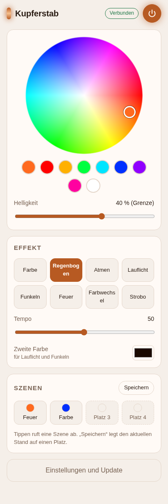

# Walkthrough 0001 · Firmware und Handy-App für den Kupferstab

**Wo:** Projekt `kupferstab`, Board-Task #258 · **Wofür:** Den Stab vom Handy aus steuern und ohne
Kabel aktualisieren. · **Stand:** fertig, wartet auf dein Urteil · **Plan:**
[0001-firmware-pwa.md](../plans/0001-firmware-pwa.md) · **PR:**
[#3](https://github.com/Niklas-Flaig/kupferstab/pull/3)

## Abweichungen vom Plan

| Geplant | Geworden | Warum |
| --- | --- | --- |
| Einstellungen als JSON auf LittleFS | Einstellungen, Zustand und Szenen im EEPROM-Bereich des Flash | Ein App-Update überschreibt das ganze Dateisystem und hätte LED-Anzahl, Pin und WLAN gelöscht. |
| Update nur über die App | Zusätzlich die Notfall-Seite `/update`, fest in der Firmware | Fehlt die App oder geht ein App-Update schief, bleibt ein Weg ohne USB. |
| Pin in den Einstellungen wählen | Zusätzlich „Nächsten Pin testen“: schaltet live um und spielt das Lauflicht | Antwort auf C1: Du kennst den Pin nicht und kommst nicht an den Anschluss. |
| Pull Request als Abnahme (Variante `task`) | Dieser Walkthrough | Dein Wunsch auf dem Board („gib mir bitte einmal ein walkthrough“). |

## Was jetzt geht

1. **Eigenes WLAN mit App.** Der Stab spannt das WLAN „Kupferstab“ auf (Passwort `kupferstab`).
   Beim Verbinden öffnet das Handy die App selbst, sonst unter `http://192.168.4.1`. Ohne Router,
   ohne Internet. → Plan 3.2 · [1d421fc](https://github.com/Niklas-Flaig/kupferstab/commit/1d421fc)
2. **8 Effekte.** Farbe, Regenbogen, Atmen, Lauflicht, Funkeln, Feuer, Farbwechsel und Strobo, mit
   Tempo und zweiter Farbe. Ab Werk ist die Helligkeit auf 40 % begrenzt. Beim Start läuft ein
   Kupfer-Lauflicht über alle LEDs. → Plan 3.2 · [1d421fc](https://github.com/Niklas-Flaig/kupferstab/commit/1d421fc)
3. **Updates ohne Kabel.** In der App unter Einstellungen → Update, auf der Notfall-Seite `/update`
   oder vom Laptop mit `pio run -e ota`. Eine App-Datei wird als Firmware abgelehnt. → Plan 3.2 ·
   [1d421fc](https://github.com/Niklas-Flaig/kupferstab/commit/1d421fc)
4. **Einstellungen bleiben.** LED-Anzahl, Pin, Farbreihenfolge, WLAN und Szenen überleben Neustarts
   und App-Updates. → Abweichung 1 · [1d421fc](https://github.com/Niklas-Flaig/kupferstab/commit/1d421fc)
5. **Die App.** Farbrad, Farbfelder, Helligkeit, Effekt-Kacheln, Tempo und 4 Szenen. Sie lässt sich
   zum Home-Bildschirm hinzufügen und wiegt 7,2 KB gzip. Mehrere Handys sehen dieselben Änderungen.
   → Plan 3.3 · [5dfafbf](https://github.com/Niklas-Flaig/kupferstab/commit/5dfafbf)
6. **Pin-Suche.** „Nächsten Pin testen“ schaltet live durch D4, D2, D1, D5, D6, D7, RX, D8, D3, TX.
   LED-Anzahl und Farbreihenfolge ändern sich ohne neues Flashen. → Abweichung 3 ·
   [5dfafbf](https://github.com/Niklas-Flaig/kupferstab/commit/5dfafbf)
7. **Anleitung.** Das README beschreibt das Erst-Flashen per USB (PlatformIO oder esptool-js im
   Browser), OTA-Updates und die Fehlersuche bei dunklem oder flackerndem Strip. → Plan 3.5 ·
   [24d5279](https://github.com/Niklas-Flaig/kupferstab/commit/24d5279)

  

## Entscheidungslog

Vollständig im [Plan, Abschnitt 4](../plans/0001-firmware-pwa.md#4-entscheidungslog). Wo ich ohne
Rückfrage entschieden habe:

- WLAN statt Bluetooth und eigene Firmware statt WLED: deine Antworten Q1 a und Q2 a.
- Die App liegt im Flash des Stabs. Eine HTTPS-Seite im Netz dürfte nicht mit dem Stab reden
  (Mixed Content).
- Adafruit NeoPixel statt NeoPixelBus: Pin und Anzahl lassen sich zur Laufzeit ändern. Der Preis
  dafür: Unter starker WLAN-Last kann ein Frame zucken. Das zeigt erst die echte Hardware.
- Bibliotheken und Plattform exakt gepinnt, keine Version jünger als zwei Wochen.
- Standard-Pin D4 (GPIO2), 60 LEDs, GRB: geraten, weil C1 offen blieb. In der App einstellbar.

## Nachweise

- `bun test`: **8 pass, 0 fail**, 24 Prüfungen. Abgedeckt sind Farbumrechnung, Begrenzung wie in
  der Firmware, Nachrichten und Update-Ziel.
- `tsc`: keine Fehler.
- `pio run -e d1_mini`: **SUCCESS**. Flash 423 573 B (40,6 %), RAM 33 956 B (41,5 %).
- `pio run -e d1_mini -t buildfs`: **SUCCESS**, `littlefs.bin` mit 2 MB.
- Simulierter Stab: Ein WebSocket-Client setzt `fire`/77 und bekommt den neuen Zustand zurück.
  `POST /update` mit der echten `firmware.bin` antwortet `200 OK`.
- Screenshots in Handy-Breite (400 px), hell und dunkel, gegen den simulierten Stab (oben).
- **Vorschau:** Aus dem Container gibt es keine von außen erreichbare Adresse. Den simulierten
  Stab startest du lokal mit `bun run mock` und öffnest `http://localhost:8080`.
- **Nicht geprüft:** echte Hardware. Das betrifft das Flashen, das LED-Timing unter WLAN-Last, das
  automatische Öffnen der App auf echtem iPhone/Android und ob ein Over-the-Air-Update wirklich
  durchläuft. Ohne Gerät kann ich das nicht prüfen.

## Selbst prüfen in drei Schritten

1. **Im Repo** `bun install && bun run build && bun run mock`, dann `http://localhost:8080` öffnen.
   Du siehst die App mit „Verbunden“. Eine Effekt-Kachel antippen färbt sie kupfern.
2. **D1 mini per USB anschließen**, dann in `firmware/` erst `pio run -e d1_mini -t upload` und
   danach `-t uploadfs`. Du siehst nach dem Neustart das Kupfer-Lauflicht über den Strip.
3. **Mit dem Handy ins WLAN „Kupferstab“** (Passwort `kupferstab`). Die App öffnet sich, und „Regenbogen“
   lässt den Stab in Regenbogenfarben laufen. Bleibt er dunkel: Einstellungen → „Nächsten Pin
   testen“.

## Follow-ups

- [#1](https://github.com/Niklas-Flaig/kupferstab/issues/1) Release-Build: `firmware.bin` und
  `littlefs.bin` per GitHub Action
- [#2](https://github.com/Niklas-Flaig/kupferstab/issues/2) OTA-Passwort in der App änderbar machen

## Doku-Stand

- README (neu): Party-Ablauf, Erst-Flash, OTA, Einstellungen, Fehlersuche, Entwickeln, Screenshots.
- `CONTEXT.md` (neu): Begriffe und Aufbau.
- `docs/protocol.md` (neu): alle Nachrichten und HTTP-Pfade.
- Offen: nichts.
